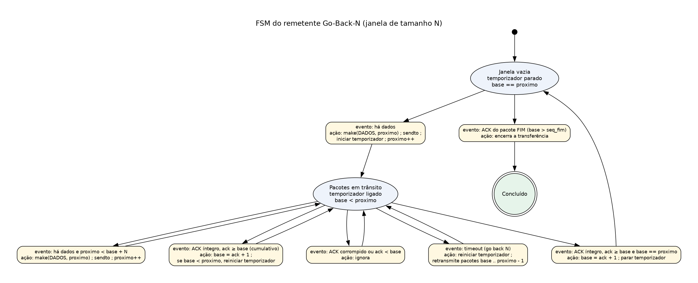
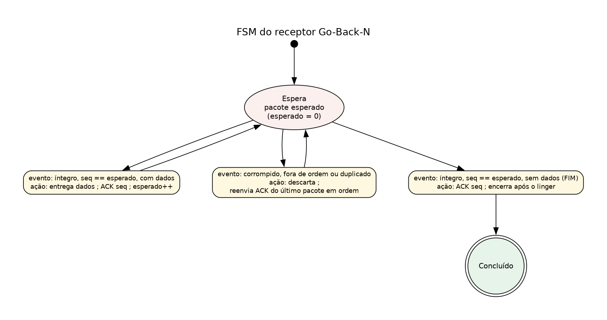

# FSM do Go-Back-N (janela deslizante sobre UDP)

Imagens prontas para o relatório: `graficos/fsm_gbn_remetente.png` e
`graficos/fsm_gbn_receptor.png` (fontes `.dot` na mesma pasta; para regerar:
`dot -Tpng -Gdpi=130 graficos/fsm_gbn_remetente.dot -o graficos/fsm_gbn_remetente.png`).
Nos diagramas, os estados são elipses e cada transição é uma caixa com o **evento** que a
dispara e a **ação** executada.

## Remetente

Dois estados: **janela vazia** (nada sem ACK, temporizador parado) e **pacotes em trânsito**
(há pacotes enviados sem ACK, temporizador ligado). O GBN usa **um único temporizador**,
associado ao pacote mais antigo sem ACK (`base`).

## Receptor

Um estado só: o receptor aceita apenas o pacote cujo número é `esperado`. Qualquer outro
pacote é descartado e o receptor repete o ACK do último pacote entregue em ordem.

## Ligação com a aula e com o código

| Elemento da FSM | Conceito da aula | Onde está no código |
| --- | --- | --- |
| `base` e `proximo` | Janela deslizante: `base` é o pacote mais antigo sem ACK e `proximo` é o próximo a enviar | variáveis `base` e `proximo` em `gbn/remetente.py` |
| `proximo < base + N` | Só pode haver N pacotes em trânsito ao mesmo tempo (controle pela janela) | laço "enche a janela" em `enviar_arquivo()` |
| Temporizador único | O GBN mede o tempo só do pacote `base` | variável `prazo` em `gbn/remetente.py` |
| ACK cumulativo (`base = ack + 1`) | `ack = k` confirma todos os pacotes até `k` de uma vez | trecho "ACK cumulativo" em `enviar_arquivo()` |
| `timeout (go back N)` | Ao estourar o tempo, reenvia **toda** a janela a partir de `base` | bloco "timeout" em `enviar_arquivo()`, que chama `transmitir(..., retransmissao=True)` |
| ACK corrompido ou `ack < base` | ACK com checksum inválido ou repetido não faz a janela andar | `Packet.extract()` devolve `None`; contador `acks_corrompidos` e `acks_duplicados` |
| `seq == esperado` | O receptor GBN não guarda pacotes fora de ordem, aceita só o esperado | variável `esperado` em `gbn/receptor.py` |
| Descarta e reenvia o último ACK | Pacote fora de ordem, duplicado ou corrompido não é entregue, e o ACK cumulativo anterior é repetido | função `repetir_ack()` em `gbn/receptor.py` |
| Pacote FIM (dados vazios) | Marca o fim do arquivo e passa pela janela como um pacote comum | `seq_fim` em `gbn/remetente.py` e `if not payload` em `gbn/receptor.py` |
| `linger` | Depois do FIM, o receptor continua respondendo caso o último ACK tenha se perdido | laço final de `receber_arquivo()` em `gbn/receptor.py` |
