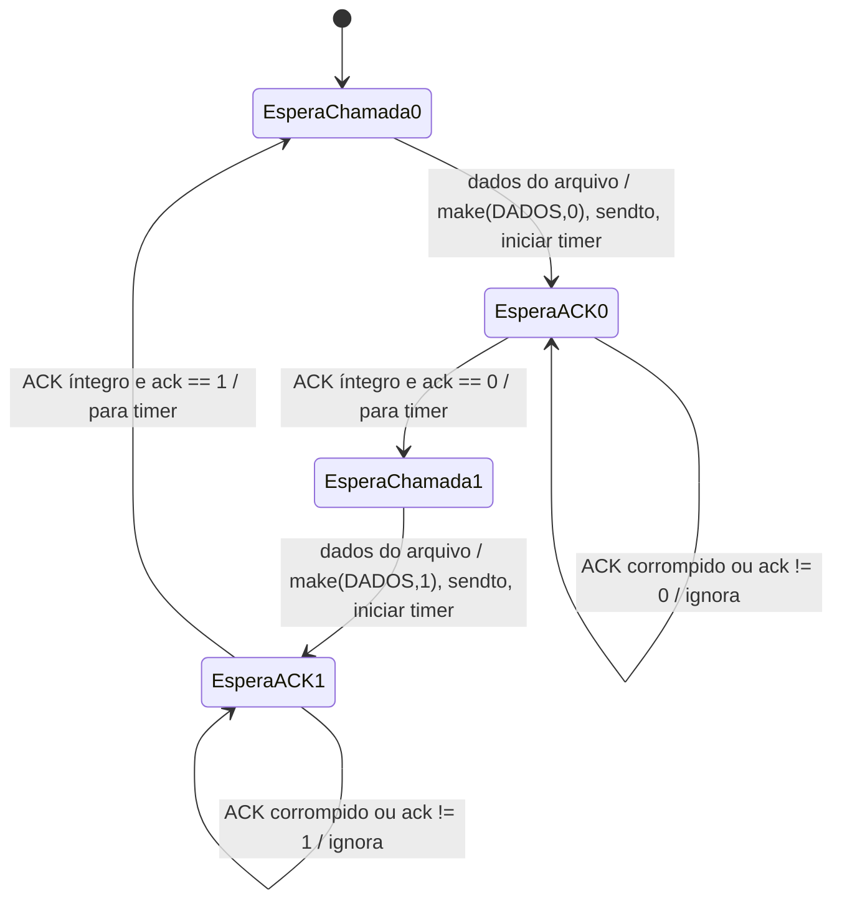
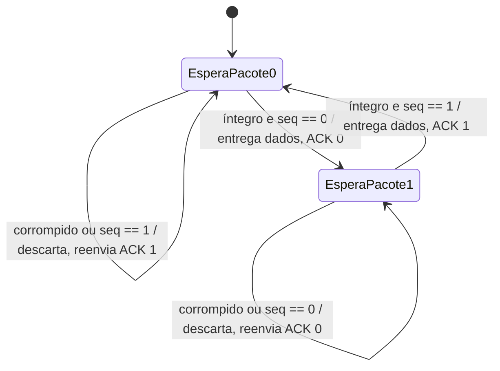

# FSM do rdt3.0 (pare-e-espera sobre UDP)

Imagens prontas para o relatório: `graficos/fsm_rdt30_remetente.png` e
`graficos/fsm_rdt30_receptor.png` (fontes `.dot` na mesma pasta; para regerar:
`dot -Tpng -Gdpi=150 graficos/fsm_rdt30_remetente.dot -o graficos/fsm_rdt30_remetente.png`).

## Remetente

## Receptor

## Ligação com a aula e com o código

| Elemento da FSM | Conceito da aula | Onde está no código |
| --- | --- | --- |
| Número de sequência 0/1 | Distingue pacote novo de retransmissão | `seq ^= 1` em `rdt30/remetente.py`, `esperado ^= 1` em `rdt30/receptor.py` |
| "íntegro" / "corrompido" | Checksum (detecção de erro de bit) | `Packet.extract()` devolve `None` se o checksum não confere |
| ACK com número | Confirmação positiva (sem NAK) | `Packet.make(ACK, 0, ack)` em `_enviar_ack()` |
| `timeout` e retransmissão | Temporizador do rdt3.0 (trata perda de pacote e de ACK) | `_enviar_e_esperar_ack()` |
| "ACK corrompido / ack != n: ignora" | rdt3.0 não reage a ACK ruim; espera o timer estourar | ramo `Packet.extract(...) is None` e `ack != seq` |
| "descarta, reenvia ACK anterior" | Receptor repete o ACK do último pacote entregue | `ultimo_ack` em `receber_arquivo()` |
| Pacote FIM (`DADOS` com 0 byte) | Sinaliza o fim do arquivo | `chunk == b""` no remetente, `not payload` no receptor |
| `linger` do receptor | Problema do último ACK perdido | laço final de `receber_arquivo()` |

## Observação sobre a utilização do canal

Como só há um pacote em trânsito por vez, a utilização do remetente é
`U = (L/R) / (RTT + L/R)`: com RTT grande, o remetente passa quase todo o tempo
parado esperando o ACK. É isso que o gráfico de utilização (pare-e-espera vs GBN
vs SR) vai mostrar.
