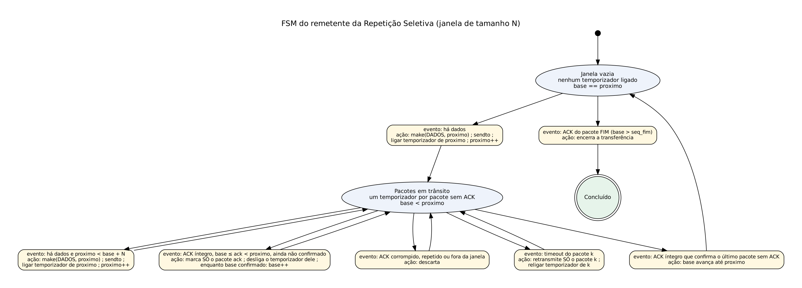
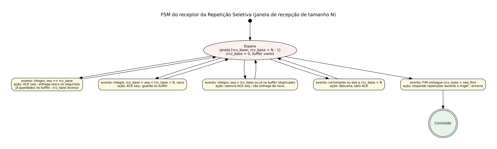

# FSM da Repetição Seletiva (janela deslizante sobre UDP)

Imagens prontas para o relatório: `graficos/fsm_sr_remetente.png` e
`graficos/fsm_sr_receptor.png` (fontes `.dot` na mesma pasta; para regerar:
`dot -Tpng -Gdpi=150 graficos/fsm_sr_remetente.dot -o graficos/fsm_sr_remetente.png`).
Nos diagramas, os estados são elipses e cada transição é uma caixa com o **evento** que a
dispara e a **ação** executada.

## Remetente

Dois estados, como no GBN: **janela vazia** (nada sem ACK, nenhum temporizador ligado) e
**pacotes em trânsito** (há pacotes enviados sem ACK). A diferença está nas transições: a SR
tem **um temporizador por pacote**, o ACK confirma **só um pacote** e o timeout reenvia
**só o pacote vencido**.

## Receptor

Um estado só, mas com uma **janela de recepção** `[rcv_base, rcv_base + N - 1]` e um buffer.
O receptor aceita qualquer pacote íntegro dentro da janela: guarda os que chegam fora de
ordem e entrega em ordem quando o buraco fecha.

## Ligação com a aula e com o código

| Elemento da FSM | Conceito da aula | Onde está no código |
| --- | --- | --- |
| `base` e `proximo` | Janela deslizante do remetente: `base` é o pacote mais antigo sem ACK e `proximo` é o próximo a enviar | variáveis `base` e `proximo` em `sr/remetente.py` |
| `proximo < base + N` | Só pode haver N pacotes em trânsito ao mesmo tempo | laço "enche a janela" em `enviar_arquivo()` |
| Temporizador por pacote | Cada pacote sem ACK tem o seu próprio prazo; o remetente espera até o menor deles | dicionário `prazos = {seq: prazo}` e `min(prazos.values())` em `sr/remetente.py` |
| ACK individual | `ack = k` confirma **só** o pacote `k`, não os anteriores | conjunto `confirmados` e `del prazos[ack]` em `enviar_arquivo()` |
| `enquanto base confirmado: base++` | A janela desliza quando os primeiros pacotes dela estão confirmados | laço `while base in confirmados` em `enviar_arquivo()` |
| `timeout do pacote k` | Ao estourar o tempo de um pacote, reenvia **só** aquele pacote | bloco "timeout" em `enviar_arquivo()`, que percorre os prazos vencidos |
| ACK corrompido, repetido ou fora da janela | Não muda o estado da janela | `Packet.extract()` devolve `None`; contadores `acks_corrompidos` e `acks_duplicados` |
| Janela de recepção `[rcv_base, rcv_base + N - 1]` | O receptor também tem janela e aceita pacotes fora de ordem dentro dela | variável `rcv_base` e parâmetro `janela` em `sr/receptor.py` |
| Buffer de fora de ordem | Pacotes que chegam antes de um buraco são guardados, não descartados | dicionário `guardados = {seq: dados}` em `sr/receptor.py` |
| Entrega em ordem | Quando chega `rcv_base`, entrega ele e todos os seguintes já guardados | laço `while rcv_base in guardados` em `receber_arquivo()` |
| Duplicado recebe ACK de novo | Se o ACK se perdeu, o remetente reenvia um pacote já recebido; o receptor repete o ACK sem entregar de novo | trecho `seq < rcv_base or seq in guardados` em `receber_arquivo()` |
| Corrompido ou acima da janela: sem ACK | Não há "último ACK" para repetir na SR; o remetente recupera por timeout | `continue` sem `_enviar_ack()` em `receber_arquivo()` |
| Pacote FIM (dados vazios) | Marca o fim do arquivo e passa pela janela como um pacote comum, inclusive fora de ordem | `seq_fim` em `sr/remetente.py` e em `sr/receptor.py` |
| `linger` | Depois do FIM, o receptor responde com o ACK de cada pacote repetido, porque ACKs de outros pacotes da última janela também podem ter se perdido | laço final de `receber_arquivo()` em `sr/receptor.py` |
