# Laboratório de Transporte Confiável: Relatório Técnico

**Disciplina:** Redes de Computadores, Universidade de Pernambuco (UPE)
**Grupo 3:** Lucas, Márcio, João Pedro, João Vitor, José Fernando e Elias
**Entrega:** 17/11/2026

> **Como usar este documento.** Cada seção tem um responsável e um prazo. Quem for o
> responsável apaga a caixa de instruções (as linhas que começam com `>`) e escreve o
> texto no lugar. Não mexam nas seções dos outros: se algo estiver errado, avisem no
> grupo. Figuras entram com caminho relativo a esta pasta, por exemplo
> ``. Texto em Markdown simples
> (títulos, listas, tabelas e imagens), porque o arquivo final será exportado para PDF.
> Prazo para todas as seções: **domingo, 15/11**. O Márcio consolida na segunda, 16/11.

---

## 1. Introdução

> **Responsável:** Márcio (escreve por último, depois das outras seções)
> **O que escrever:** o problema (transporte confiável sobre um canal que perde e corrompe
> pacotes), os objetivos do trabalho, as ferramentas usadas (Python, UDP, Wireshark,
> Mininet) e um resumo de como o relatório está organizado.

## 2. rdt3.0: pare-e-espera sobre UDP

> **Responsável:** Lucas (requisito A)
> **O que escrever:** o formato do pacote (tipo, número de sequência, ACK, checksum,
> tamanho), o funcionamento do rdt3.0 (sequência 0/1, ACK, temporizador, retransmissão),
> a FSM e a validação com SHA-256.
> **Material pronto:** `relatorio/fsm_rdt30.md`, `graficos/fsm_rdt30_remetente.png`,
> `graficos/fsm_rdt30_receptor.png`, `common/packet.py`, `rdt30/`.

## 3. Go-Back-N

### 3.1 Funcionamento

O Go-Back-N (GBN) é um protocolo de **janela deslizante**: em vez de esperar o ACK de cada
pacote, como o rdt3.0, o remetente pode ter até **N pacotes enviados e ainda não
confirmados**. Isso mantém o canal ocupado enquanto os ACKs voltam.

O remetente controla a janela com duas variáveis: `base`, o número de sequência do pacote
mais antigo sem ACK, e `proximo`, o número do próximo pacote a enviar. Ele só envia quando
`proximo < base + N`. As regras são:

- **ACK cumulativo:** um ACK com número `k` confirma todos os pacotes até `k`. Ao recebê-lo,
  o remetente faz `base = k + 1` e a janela desliza.
- **Temporizador único:** há um só temporizador, associado ao pacote `base`. Ele liga ao
  enviar o primeiro pacote da janela, reinicia quando a base avança e para quando não há
  nada em trânsito.
- **Timeout:** se o ACK de `base` não chega a tempo, o remetente **volta N** (*go back N*):
  retransmite todos os pacotes da janela, de `base` até `proximo - 1`.
- **Receptor sem buffer:** o receptor aceita **somente o pacote esperado**. Pacote fora de
  ordem, duplicado ou com checksum inválido é descartado e o receptor reenvia o ACK do
  último pacote entregue em ordem.

Com N = 1 o GBN se reduz ao pare-e-espera. Quanto maior o N, mais pacotes ficam em trânsito,
mas cada perda custa mais caro, porque força a retransmissão da janela inteira (seção 3.5).

### 3.2 Máquina de estados (FSM)

O remetente tem dois estados: **janela vazia** (temporizador parado) e **pacotes em
trânsito** (temporizador ligado). O receptor tem um estado só, que espera o pacote de número
`esperado`.

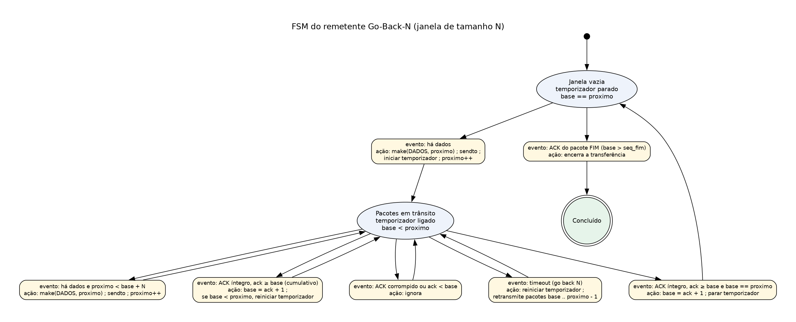

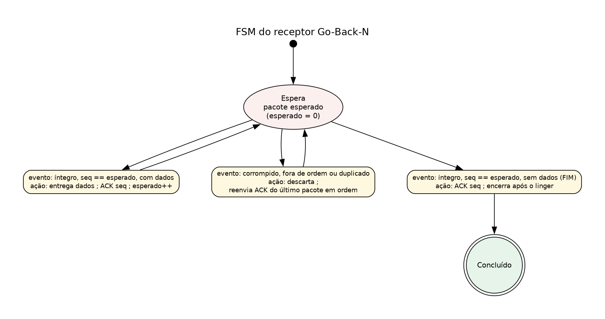

A tabela que liga cada elemento da FSM ao conceito da aula e ao trecho do código está em
`relatorio/fsm_gbn.md`.

### 3.3 Implementação

A implementação está em `gbn/remetente.py` e `gbn/receptor.py`, escrita em Python sobre
UDP e no mesmo padrão do rdt3.0 e da Repetição Seletiva, para os três protocolos serem
executados e comparados do mesmo jeito.

- **Formato do pacote e canal:** usa a classe `Packet` (`common/packet.py`), com número de
  sequência e de ACK de 4 bytes e checksum de 16 bits, e o canal não confiável
  (`common/channel.py`), que injeta perda, corrupção e atraso. Um pacote com checksum
  inválido é descartado como se nunca tivesse chegado (`Packet.extract()` devolve `None`).
- **Remetente de uma thread só:** um laço alterna entre encher a janela e esperar um ACK até
  o prazo do temporizador. Não há travas, porque nenhuma estrutura é compartilhada.
- **Fim do arquivo:** é sinalizado por um pacote de dados **vazio**, que passa pela janela
  como um pacote comum. Depois de confirmá-lo, o receptor espera um tempo (*linger*) para
  responder caso o último ACK tenha se perdido.
- **ACK inicial:** o campo de ACK não tem sinal, então, enquanto nada foi entregue, o
  receptor não envia ACK e o remetente recupera por timeout.
- **Parâmetros:** a janela é escolhida por `--janela` (padrão 8). Timeout padrão de 0,1 s e
  1024 bytes de dados por pacote, os mesmos valores do rdt3.0.
- **Métricas e log:** o remetente devolve tempo total, retransmissões, pacotes enviados,
  ACKs corrompidos e duplicados e bytes úteis, gravados por `common/metricas.py`. O log de
  eventos usa os termos `RETRANSMISSÃO`, `TIMEOUT` e `ACK CORROMPIDO`.

Exemplo de execução, em dois terminais:

```bash
python gbn/receptor.py --porta 5000 --saida recebido.bin
python gbn/remetente.py arquivo.bin --porta 5000 --janela 8 --perda 0.1 --seed 42
```

### 3.4 Resultados nos cenários de teste

A suíte automatizada (`testes/test_suite.py`) transfere um arquivo em cada cenário e compara
o SHA-256 do arquivo recebido com o do enviado. O GBN passou nos cinco cenários, sempre com
hash igual. Os números abaixo vêm de `capturas/resultados_testes.md`:

| Cenário | Hash | Tempo (s) | Retransmissões | Pacotes perdidos | Pacotes corrompidos | Detectados pelo checksum |
| --- | --- | --- | --- | --- | --- | --- |
| sem falhas | OK | 0,03 | 0 | 0 | 0 | 0 |
| 10% de perda | OK | 0,68 | 88 | 35 | 0 | 0 |
| 20% de perda | OK | 1,49 | 178 | 95 | 0 | 0 |
| só corrupção (20%) | OK | 1,80 | 226 | 0 | 139 | 139 |
| perda 10% + corrupção 10% | OK | 1,61 | 206 | 67 | 59 | 59 |

Dois pontos aparecem na tabela:

- **Toda corrupção foi detectada:** o número de pacotes corrompidos é igual ao detectado pelo
  checksum, então nenhum pacote com erro chegou à aplicação.
- **Muitas retransmissões:** com 10% de perda, o GBN fez 88 retransmissões para 35 pacotes
  perdidos, enquanto o rdt3.0 e a Repetição Seletiva fizeram 27, uma por perda. A diferença
  é o custo do *go back N*: cada timeout reenvia também pacotes que já tinham chegado.

Em tempo total os protocolos ficaram próximos nesses testes curtos: com 10% de perda, o GBN
levou 0,68 s, a SR 0,86 s e o rdt3.0 1,67 s. Como o arquivo é pequeno e os tempos dependem do
timeout, a comparação de desempenho é feita na seção 5, com atraso e taxa de enlace.

### 3.5 Comportamento observado

Os experimentos da seção 5 usam um arquivo de 100 KB, enlace de 1 Mbit/s, RTT de 40 ms e
três repetições por ponto. A utilização é a fração da taxa do enlace usada por dados úteis.
Valores médios para o GBN, com a Repetição Seletiva ao lado:

| Janela N | GBN, sem perda | SR, sem perda | GBN, 5% de perda | SR, 5% de perda |
| --- | --- | --- | --- | --- |
| 1 | 16,3% | 16,4% | 14,1% | 14,1% |
| 2 | 32,4% | 32,4% | 25,2% | 24,6% |
| 4 | 63,8% | 63,8% | 40,0% | 38,0% |
| 8 | 94,0% | 94,1% | 50,1% | 49,6% |
| 16 | 94,0% | 94,0% | 49,7% | 58,0% |
| 32 | 94,0% | 94,0% | 28,9% | 62,3% |

**Sem perda.** A utilização cresce quase linearmente com N e satura em cerca de 94%. Um
pacote de 1037 bytes (1024 de dados e 13 de cabeçalho) leva 8,3 ms para sair do enlace e o
RTT é de 40 ms, então são necessários cerca de 1 + 40 / 8,3 ≈ 6 pacotes em trânsito para manter o canal ocupado. Isso
explica por que N = 8 já satura e N = 16 e N = 32 não melhoram. Com N = 1, o GBN usa 16,3%,
o mesmo valor do rdt3.0 (16,3%), como esperado.

**Com 5% de perda.** O GBN melhora até N = 8 (50,1%), fica estável em N = 16 (49,7%) e
**cai para 28,9% com N = 32**. A Repetição Seletiva, ao contrário, continua melhorando e
chega a 62,3%. A causa é o *go back N*: com janela grande, cada perda obriga o remetente a
reenviar até N pacotes, e o receptor descarta os que chegaram fora de ordem. Em uma janela de
32 pacotes, uma só perda pode desperdiçar dezenas de transmissões. O experimento também
aumenta o timeout junto com a janela (RTT mais o tempo de a janela sair do enlace), o que
contribui para a queda em N = 32, porque o remetente demora mais para perceber a perda.

**Limitações da implementação.** O timeout é fixo, sem adaptação ao RTT medido, e o receptor
não guarda pacotes fora de ordem, por isso a Repetição Seletiva é mais eficiente em canais
com perda. O número de sequência de 4 bytes evita a volta ao zero nos arquivos usados.

## 4. Repetição Seletiva

> **Responsável:** João Pedro (requisito B)
> **O que escrever:** o funcionamento da SR (janela no remetente e no receptor, buffer de
> pacotes fora de ordem, ACK individual, temporizador por pacote), a implementação,
> os resultados e a diferença em relação ao Go-Back-N.
> **Material pronto:** `sr/`, `testes/validar_sr.py`, `capturas/resultados_testes.md`.

## 5. Comparação da utilização do canal

> **Responsável:** Lucas (requisito A e comparação do B)
> **O que escrever:** como foram feitos os experimentos (mesmo arquivo, mesma perda e
> mesmo atraso, variando a janela), o gráfico de utilização do canal (pare-e-espera,
> GBN e SR) e a discussão dos resultados.
> **Material pronto:** `graficos/grafico_utilizacao.png`, `graficos/utilizacao_resumo.csv`,
> `testes/experimentos.py`, `graficos/plot_utilizacao.py`.

## 6. Injeção de falhas e testes

> **Responsável:** João Vitor (requisito C)
> **O que escrever:** o canal que simula a rede não confiável (perda, corrupção por
> inversão de bits, atraso, semente fixa), os 5 cenários de teste, a tabela de resultados
> e a sequência detecção, descarte, timeout e retransmissão mostrada nos logs.
> **Material pronto:** `common/channel.py`, `common/enlace.py`, `testes/test_suite.py`,
> `capturas/resultados_testes.md`, `capturas/logs_testes/`.

## 7. Análise de uma conexão TCP real

### 7.1 Captura utilizada

Esta seção dissecta uma conexão TCP real capturada no Wireshark e compara o ACK cumulativo do TCP com o dos protocolos GBN e Repetição Seletiva (SR) implementados pelo grupo. Para facilitar a leitura dos pacotes, a captura usou HTTP simples (porta 80, sem criptografia) a uma página de teste, e a análise considera só a conexão do filtro `tcp.port == 61097`. A captura está em `capturas/captura_tcp_http.pcapng` e os prints anotados estão em `capturas/prints_tcp/`.

| Item | Valor |
| --- | --- |
| Arquivo | captura_tcp_http.pcapng (167 pacotes) |
| Cliente | 2804:29b8:51e3:29c9:1d84:c1f7:3c35:ae39, porta 61097 |
| Servidor | 2600:1f13:37c:1400:ba21:7165:5fc7:736e, porta 80 |
| Protocolo | TCP sobre IPv6; aplicação HTTP/1.1 (`GET /`) |
| Número de sequência inicial (ISN) | cliente 2428730781; servidor 543639397 |
| Filtro de exibição | `tcp.port == 61097` |

Os números de sequência e de confirmação são mostrados como o Wireshark os exibe por padrão, relativos ao início da conexão (a partir de 0); os valores brutos aparecem só quando ajudam.

### 7.2 Handshake de três vias

A conexão só foi estabelecida na quinta tentativa de SYN (frame 101), e o handshake terminou com o ACK do cliente no frame 104, em 18,173 s da captura. As tentativas anteriores são tratadas na seção 7.4.

| Frame | Sentido | Flags | Seq | Ack | Janela (bytes) |
| --- | --- | --- | --- | --- | --- |
| 101 | cliente → servidor | SYN | 0 | — | 64800 |
| 103 | servidor → cliente | SYN, ACK | 0 | 1 | 26883 |
| 104 | cliente → servidor | ACK | 1 | 1 | 64800 |

- **Os SYNs consomem um número de sequência.** O servidor confirma com Ack=1, ou seja, ISN do cliente + 1 (valor bruto: 2428730781 + 1). O primeiro byte de dados do cliente terá, por isso, Seq=1.
- **Cada lado escolhe o seu ISN.** O do servidor é 543639397, e o frame 104 confirma o SYN dele com Ack=1 (relativo), ou seja, 543639398 em valor bruto.
- **Janela anunciada.** O cliente anuncia 64800 bytes e o servidor 26883 bytes. O SYN-ACK não traz a opção de escala de janela, então o escalonamento não é usado na conexão e o Wireshark exibe o fator de escala como -2 ("no window scaling used"): a janela calculada é igual ao campo Window.
- **Tempo de ida e volta inicial (iRTT).** O intervalo entre o SYN (frame 101) e o ACK (frame 104) é de 158,2 ms.

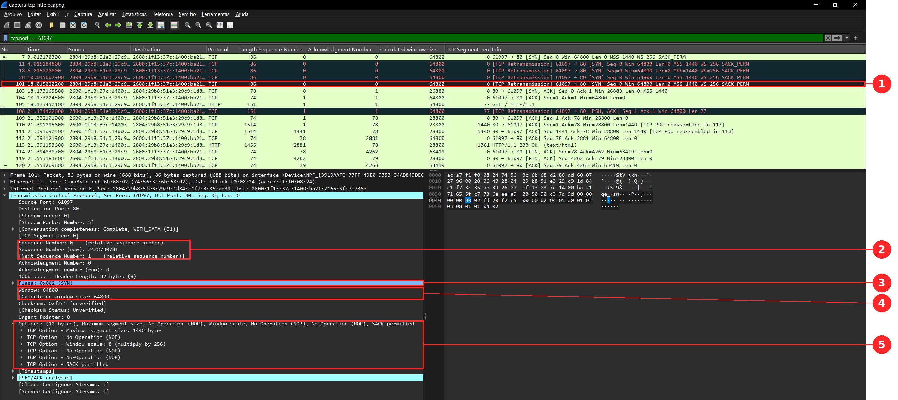

*Figura 7.1 — Frame 101: SYN do cliente (61097 → 80), Seq=0 relativo (bruto 2428730781), janela 64800 e opções MSS=1440, escala de janela 256 e SACK permitido. Marcadores: [1] linha do frame 101; [2] número de sequência relativo e bruto; [3] flag SYN; [4] janela; [5] opções TCP (MSS, escala de janela e SACK permitido).*

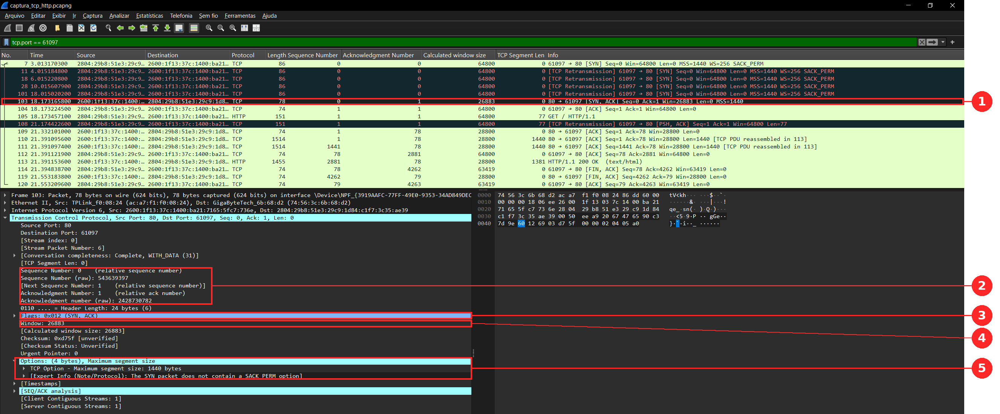

*Figura 7.2 — Frame 103: SYN-ACK do servidor, Seq=0 (bruto 543639397), Ack=1 e janela 26883, sem opção de escala de janela. Marcadores: [1] linha do frame 103; [2] Seq e Ack, relativos e brutos (Ack bruto 2428730782 = ISN do cliente + 1); [3] flags SYN,ACK; [4] janela; [5] opções: só o MSS, sem escala de janela e sem SACK.*

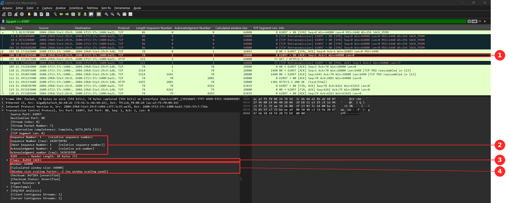

*Figura 7.3 — Frame 104: ACK do cliente (Seq=1, Ack=1, janela 64800), que conclui o handshake. Marcadores: [1] linha do frame 104; [2] Seq=1 e Ack=1 (Ack bruto 543639398 = ISN do servidor + 1); [3] flag ACK; [4] janela 64800 sem escalonamento (fator -2).*

### 7.3 Troca de dados: sequência, ACK e janela

O cliente enviou 77 bytes (a requisição `GET / HTTP/1.1`) e recebeu 4261 bytes de resposta, em três segmentos do servidor. Em todo o fluxo, o ACK é igual ao número de sequência mais os bytes recebidos em ordem.

| Frame | Tempo (s) | Sentido | Seq | Ack | Bytes de dados | Janela |
| --- | --- | --- | --- | --- | --- | --- |
| 105 | 18,173 | cliente → servidor | 1 | 1 | 77 (GET) | 64800 |
| 109 | 21,332 | servidor → cliente | 1 | 78 | 0 | 28800 |
| 110 | 21,391 | servidor → cliente | 1 | 78 | 1440 | 28800 |
| 111 | 21,391 | servidor → cliente | 1441 | 78 | 1440 | 28800 |
| 112 | 21,391 | cliente → servidor | 78 | 2881 | 0 | 64800 |
| 113 | 21,391 | servidor → cliente | 2881 | 78 | 1381 (200 OK) | 28800 |

- **Sequência e ACK.** O GET ocupa os bytes 1 a 77 do cliente, e o servidor responde com Ack=78 (1 + 77). Os três segmentos de resposta ocupam os bytes 1 a 4261 do servidor (1440 + 1440 + 1381), e o cliente os confirma por completo com Ack=4262 no frame 114. O campo "Next Sequence Number" do Wireshark é sempre Seq + bytes de dados.
- **Tamanho do segmento.** O MSS anunciado pelo cliente no SYN é 1440 bytes; os dois primeiros segmentos da resposta o preenchem, e o terceiro leva o restante.
- **Controle de fluxo.** A janela do servidor passou de 26883 (no SYN-ACK) para 28800 e ficou assim durante a resposta; a do cliente ficou em 64800 e chegou a 63419 no FIN. A diferença de 1381 bytes coincide com o tamanho do último segmento recebido (frame 113).
- **Reconstrução do fluxo.** O Follow TCP Stream junta os bytes na ordem da sequência e totaliza 4338 bytes (77 do cliente + 4261 do servidor); a requisição retransmitida não é contada duas vezes.

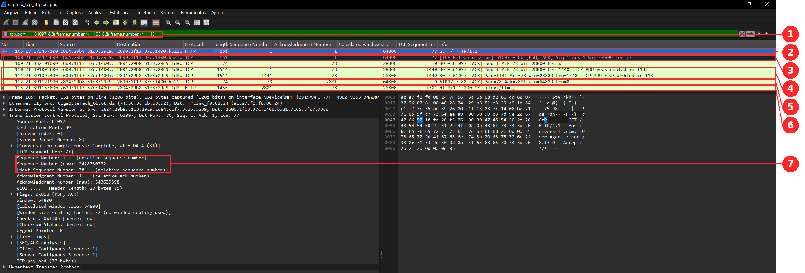

*Figura 7.4 — Frames 105 a 113: o GET de 77 bytes (105) e sua retransmissão em vermelho (108), o ACK do servidor (109), dois segmentos de 1440 bytes (110 e 111), o ACK cumulativo do cliente (112, Ack=2881) e o último segmento com o 200 OK (113, 1381 bytes). O painel de detalhes mostra o frame 105: Seq=1 e Next Sequence Number=78. Marcadores: [1] filtro; [2] GET (105); [3] retransmissão do GET (108); [4] segmentos de dados do servidor (110 e 111); [5] ACK cumulativo (112); [6] último segmento (113); [7] Seq, Seq bruto e Next Sequence Number do frame 105.*

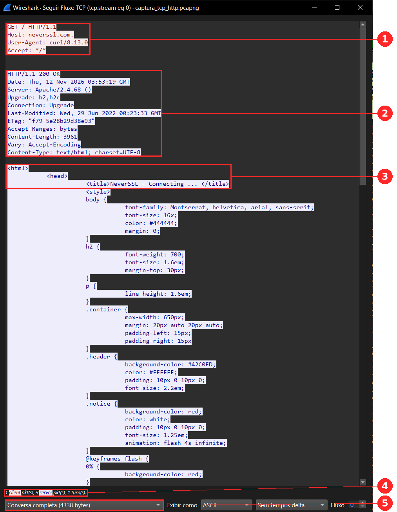

*Figura 7.5 — Follow TCP Stream: em vermelho, os 77 bytes do GET; em azul, os 4261 bytes da resposta HTTP, num total de 4338 bytes. Marcadores: [1] requisição do cliente; [2] status e cabeçalhos da resposta (Content-Length: 3961); [3] início do HTML; [4] contagem de pacotes (1 do cliente, 3 do servidor); [5] tamanho total da conversa.*

### 7.4 Retransmissões e timeout

O TCP retransmitiu o SYN quatro vezes e depois o GET uma vez, sempre por estouro de temporizador (não houve ACKs duplicados). O servidor só respondeu ao quinto SYN, 15,16 s depois do primeiro.

| Frame | Tempo (s) | Segmento | Intervalo desde o anterior (s) |
| --- | --- | --- | --- |
| 7 | 3,013 | SYN | — |
| 11 | 4,015 | SYN (retransmissão 1) | 1,0 |
| 18 | 6,015 | SYN (retransmissão 2) | 2,0 |
| 28 | 10,016 | SYN (retransmissão 3) | 4,0 |
| 101 | 18,015 | SYN (retransmissão 4) | 8,0 |
| 105 | 18,173 | GET (original) | — |
| 108 | 21,174 | GET (retransmissão) | 3,0 |

- **Backoff exponencial.** Os intervalos entre os SYNs dobram a cada tentativa (1, 2, 4 e 8 s). Cada estouro do temporizador duplica o tempo de espera seguinte, para não sobrecarregar uma rede que pode estar congestionada.
- **Intervalo de 3 s no GET.** Após um SYN retransmitido, a RFC 6298 (seção 5.7) manda reiniciar o RTO em 3 s quando os dados começam a ser enviados, o que coincide com o intervalo medido entre os frames 105 e 108. O servidor confirmou a retransmissão (Ack=78) 158 ms depois, no frame 109.
- **Relação com o rdt3.0.** É o mesmo mecanismo de temporizador do rdt3.0 e do GBN (enviar de novo o que não foi confirmado a tempo), com uma diferença: o TCP calcula o tempo limite a partir do RTT medido e o duplica a cada falha, enquanto as implementações do grupo usam um timeout fixo de 0,1 s.
- **O que o Wireshark sinaliza.** Os pacotes marcados como `[TCP Retransmission]` aparecem em vermelho no Flow Graph (Figura 7.7), que mostra a conexão inteira em ordem cronológica.

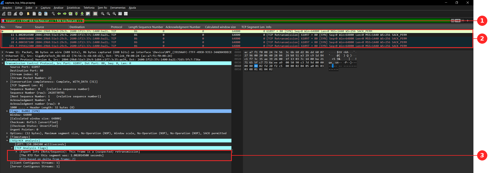

*Figura 7.6 — Filtro `tcp.port == 61097 && tcp.flags.syn == 1 && tcp.flags.ack == 0`: o SYN original (frame 7) e as quatro retransmissões (frames 11, 18, 28 e 101), com intervalos de 1,0, 2,0, 4,0 e 8,0 s. O detalhe do frame 11 mostra o aviso de retransmissão do Wireshark e o RTO de 1,002 s. Marcadores: [1] filtro; [2] os cinco SYNs, com o tempo relativo ao pacote anterior na coluna Time; [3] aviso de retransmissão e RTO.*

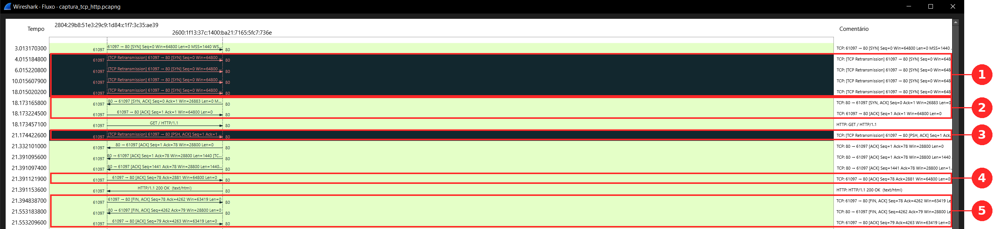

*Figura 7.7 — Flow Graph da conexão inteira: as linhas escuras são as retransmissões (quatro SYNs e o GET); o handshake termina em 18,17 s, e o ACK Ack=2881 confirma de uma vez os dois segmentos de 1440 bytes. Marcadores: [1] retransmissões do SYN; [2] SYN-ACK e ACK do handshake; [3] retransmissão do GET; [4] ACK cumulativo; [5] encerramento.*

### 7.5 Encerramento (FIN/ACK)

O cliente iniciou o fechamento, e a conexão foi encerrada em três segmentos, e não em quatro, porque o servidor juntou o ACK do FIN do cliente com o seu próprio FIN.

| Frame | Tempo (s) | Sentido | Flags | Seq | Ack | Janela |
| --- | --- | --- | --- | --- | --- | --- |
| 114 | 21,395 | cliente → servidor | FIN, ACK | 78 | 4262 | 63419 |
| 119 | 21,553 | servidor → cliente | FIN, ACK | 4262 | 79 | 28800 |
| 120 | 21,553 | cliente → servidor | ACK | 79 | 4263 | 63419 |

- **O FIN consome um número de sequência**, como o SYN. O FIN do cliente (Seq=78) é confirmado com Ack=79, e o FIN do servidor (Seq=4262) com Ack=4263.
- **O FIN do cliente também confirma os dados.** O Ack=4262 do frame 114 cobre os 4261 bytes da resposta, inclusive o último segmento (frame 113).
- **Nenhum dado depois do FIN.** Os segmentos têm 0 byte de dados; o fechamento só ocorreu depois de a resposta HTTP ter sido entregue por inteiro.
- **Tempo.** O servidor respondeu ao FIN em 158 ms (frames 114 e 119), valor próximo do iRTT do handshake (158,2 ms), e o ACK final saiu 26 µs depois do FIN do servidor.

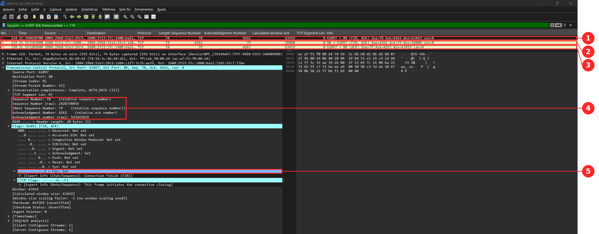

*Figura 7.8 — Frames 114, 119 e 120: FIN,ACK do cliente (Seq=78, Ack=4262), FIN,ACK do servidor (Seq=4262, Ack=79) e ACK final do cliente (Seq=79, Ack=4263). O detalhe do frame 114 mostra a flag FIN ativada. Marcadores: [1] a [3] os três segmentos do encerramento; [4] Seq e Ack do frame 114, relativos e brutos; [5] flag FIN.*

### 7.6 ACK cumulativo do TCP versus GBN e Repetição Seletiva

O TCP usa ACK cumulativo, como o GBN, mas retransmite como a Repetição Seletiva: na captura, o ACK do frame 112 (Ack=2881) confirmou de uma vez os dois segmentos de 1440 bytes dos frames 110 e 111. Na SR, cada um receberia um ACK individual.

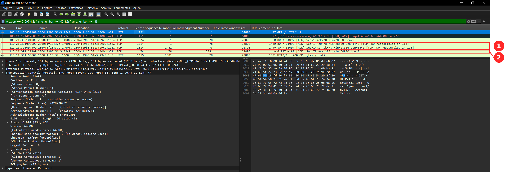

*Figura 7.9 — Os mesmos frames da Figura 7.4: os frames 110 e 111 (1440 bytes cada) são confirmados por um único ACK, o frame 112 (Ack=2881), um ACK cumulativo. Marcadores: [1] segmentos 110 e 111; [2] ACK do frame 112.*

| Característica | TCP | GBN (grupo) | Repetição Seletiva (grupo) |
| --- | --- | --- | --- |
| Unidade numerada | byte | pacote | pacote |
| Tipo de ACK | cumulativo: Ack = próximo byte esperado | cumulativo | individual, por pacote |
| Segmento fora de ordem | em geral fica no buffer do receptor; o ACK repete o último byte em ordem (ACK duplicado) | descartado | guardado no buffer e confirmado |
| Retransmissão por timeout | só o segmento mais antigo sem ACK | todos os pacotes da janela a partir da base | só o pacote cujo temporizador estourou |
| Timeout | calculado a partir do RTT e dobrado a cada falha | fixo (0,1 s) | fixo (0,1 s) |
| Aviso de perda sem esperar o timeout | 3 ACKs duplicados (retransmissão rápida); SACK opcional | não há | o próprio ACK individual mostra o que falta |
| Tamanho da janela | definido pelo receptor (janela anunciada) e pela rede (controle de congestionamento) | N pacotes (N = 8) | N pacotes (N = 8) |

- **O que a captura comprova.** O ACK cumulativo (frame 112, Ack=2881), a retransmissão por timeout (SYN e GET) e a janela anunciada pelo receptor. O Ack=4262 do FIN (frame 114) também confirma de uma vez o segmento do frame 113.
- **O que a captura não mostra.** Como não houve perda de dados nem pacotes fora de ordem, não aparecem ACKs duplicados nem retransmissão rápida, e o SACK não foi negociado (o SYN-ACK do servidor não traz essa opção). Essas linhas da tabela vêm da especificação do TCP, não desta captura.
- **Consequência prática.** Com ACK cumulativo, um ACK perdido costuma ser coberto pelo ACK seguinte, enquanto na SR a perda de um ACK individual faz o remetente retransmitir um pacote que o receptor já tinha.

## 8. Por que o TCP é justo (fairness)

O TCP é justo porque cada fluxo aumenta a janela de congestionamento de forma aditiva e a reduz de forma multiplicativa (AIMD), o que faz fluxos que dividem o mesmo gargalo convergirem para taxas iguais. Na medição feita no Mininet (gargalo de 5 Mbit/s, fila de 15 pacotes), a cwnd média foi de 34,3 segmentos no fluxo 1 e de 32,3 no fluxo 2 entre 10 s e 20 s, mesmo com o fluxo 2 entrando só aos 5 s.

- **Definição.** Um protocolo é justo quando n fluxos que atravessam o mesmo gargalo de capacidade R ficam com cerca de R/n cada um.
- **Aumento aditivo.** Sem perdas, cada fluxo soma 1 segmento à janela por RTT. Os dois ganham o mesmo tanto, então a diferença entre as janelas não muda.
- **Redução multiplicativa.** Ao detectar perda, cada fluxo multiplica a janela por um fator menor que 1. A diferença entre as janelas encolhe na mesma proporção, e o fluxo maior perde mais em valor absoluto.
- **Convergência.** Repetido a cada perda, esse ciclo aproxima as duas janelas (argumento clássico de Chiu e Jain, do livro-texto da disciplina), e a soma das taxas oscila em torno da capacidade do enlace.
- **CUBIC no experimento.** O Linux usa CUBIC por padrão, e o `ss` mostra `cubic` nas medições. A cwnd caiu para cerca de 0,7 do valor anterior (mediana de 0,74 no fluxo 1 e de 0,73 no fluxo 2), e não para a metade do AIMD clássico, mas o princípio da redução multiplicativa é o mesmo.
- **Limites da justiça.** Fluxos com RTT menor crescem mais rápido e ficam com fatia maior; quem abre várias conexões em paralelo recebe mais; e um fluxo UDP, que não reduz a taxa, não é justo com o TCP.

### 8.1 Medição com dois fluxos

A topologia (`testes/topologia_gargalo.py`) liga h1 a h2 por um switch: acesso de 100 Mbit/s e 5 ms, e gargalo de 5 Mbit/s, 20 ms e fila de 15 pacotes, o que dá um RTT base de 50 ms. Dois fluxos `iperf3` foram de h1 para h2, o fluxo 1 a partir de 0 s e o fluxo 2 a partir de 5 s, e a cwnd de cada um foi coletada com `ss -ti` (`capturas/cwnd_fluxo1.txt` e `capturas/cwnd_fluxo2.txt`).

| Medida | Fluxo 1 | Fluxo 2 |
| --- | --- | --- |
| Início | 0 s | 5 s |
| Duração (tempo ocupado da conexão) | 20,3 s | 15,3 s |
| Dados confirmados (`bytes_acked`) | 8,51 MB | 6,10 MB |
| cwnd média de 10 s a 20 s | 34,3 | 32,3 |
| Faixa da cwnd de 10 s a 20 s | 27 a 39 | 19 a 41 |
| Pico da cwnd (partida lenta) | 46 | 75 |
| Bytes retransmitidos | 0,53% | 1,78% |
| RTT mínimo | 51,6 ms | 52,6 ms |

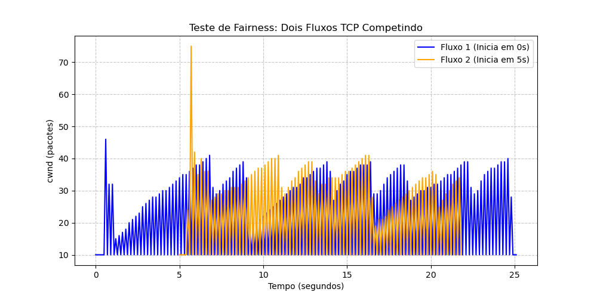

*Figura 8.1 — cwnd dos dois fluxos TCP no gargalo de 5 Mbit/s (`graficos/grafico_fairness.png`). Depois do pico de 75 segmentos do fluxo 2 ao entrar, as duas curvas oscilam na mesma faixa, com quedas em momentos diferentes. Nota: as quedas até 10 segmentos que aparecem em toda a curva vêm de amostras da conexão de controle do iperf3 (cwnd fixa em 10), misturadas às da conexão de dados nos arquivos de captura; considerando só a conexão de dados, de 10 s a 20 s a cwnd oscila entre 27 e 39 segmentos no fluxo 1 e entre 19 e 41 no fluxo 2, como na tabela acima.*

- **Entrada do fluxo 2.** A partida lenta do fluxo 2 chega a 75 segmentos e enche a fila do gargalo; o fluxo 1 sofre uma redução logo depois (de 41 para cerca de 31 segmentos). Por isso o fluxo 2 também retransmitiu mais (1,78% contra 0,53%).
- **Mesma regra, mesmo resultado.** Os RTTs mínimos são quase iguais (51,6 e 52,6 ms), então os dois crescem à mesma velocidade e a cwnd média ficou próxima (razão de 0,94 entre o fluxo 2 e o fluxo 1).
- **Divisão do gargalo.** Entre 5 s e 20 s, o fluxo 1 ficou com cerca de 53% dos bytes confirmados e o fluxo 2 com cerca de 47%, o que dá um índice de Jain de 0,997 (1 é igualdade perfeita).
- **Ressalvas.** Foi uma única execução. O `ss` não grava horário, então o tempo foi estimado pelo campo `busy` de cada conexão, e por isso só a proporção entre os fluxos é usada, não as taxas absolutas. Os dois fluxos têm o mesmo RTT; com RTTs diferentes a divisão não seria igual.

## 9. Controle de congestionamento (bônus)

> **Responsável:** Elias (requisito E)
> **O que escrever:** a topologia com enlace gargalo, a partida lenta e o padrão
> dente-de-serra do AIMD, e a análise do gráfico da cwnd.
> **Material pronto:** `relatorio/analise_tcp.md` (pode ser incorporado aqui),
> `graficos/grafico_cwnd.png`, `testes/topologia_gargalo.py`.

## 10. Conclusão

> **Responsável:** Márcio (escreve por último)
> **O que escrever:** o que o grupo aprendeu, os resultados principais (GBN versus SR,
> pare-e-espera versus janela deslizante, TCP real) e as limitações do trabalho.

## Referências

> Livros e materiais da disciplina usados no trabalho.

## Apêndice: como executar

> **Responsável:** João Pedro (a partir do `README.md` do repositório)
> Comandos para rodar cada protocolo e os testes.
