# Laboratório de Transporte Confiável: Relatório Técnico

**Disciplina:** Redes de Computadores, Universidade de Pernambuco (UPE)
**Grupo 3:** Lucas, Márcio, João Pedro, João Vitor, José Fernando e Elias
**Entrega:** 17 de novembro de 2026

---

## 1. Introdução

A Internet entrega pacotes sem garantia: uma fila cheia descarta pacotes, o ruído troca bits e o caminho pode entregar os dados fora de ordem. O IP não corrige nada disso, e o UDP, que só acrescenta portas e um checksum, herda todas as falhas. O TCP resolve o problema, mas por dentro do sistema operacional, como uma caixa fechada.

Este trabalho constrói essa confiabilidade **na camada de aplicação, sobre UDP**, para ver de perto como ela funciona. O grupo implementou em Python três protocolos de transferência confiável de arquivos, cada um mais eficiente que o anterior (rdt3.0, Go-Back-N e Repetição Seletiva), submeteu os três a um canal que perde e corrompe pacotes de forma controlada e comparou o resultado com um protocolo real, o TCP, observado no Wireshark e no Mininet. Os protocolos usam só a biblioteca padrão do Python; o SHA-256 do arquivo recebido prova a entrega confiável.

| Requisito | O que foi feito | Seção |
| --- | --- | --- |
| A | rdt3.0, pare-e-espera sobre UDP, validado pelo SHA-256 do arquivo | 2 |
| B | Go-Back-N e Repetição Seletiva, comparados ao rdt3.0 pela utilização do canal | 3, 4 e 5 |
| C | Canal que perde, corrompe e atrasa pacotes, e suíte de 15 testes com logs | 6 |
| D | Análise de uma conexão TCP real no Wireshark e texto sobre a justiça do TCP | 7 e 8 |
| E (bônus) | Controle de congestionamento do TCP: gráfico da cwnd no Mininet | 9 |

O código está em `common/` (pacote, canal, métricas), `rdt30/`, `gbn/` e `sr/`, com os testes em `testes/`, as evidências em `capturas/` e `graficos/`. O `README.md` da raiz traz os comandos para executar cada parte.

---

## 2. rdt3.0: pare-e-espera sobre UDP

O rdt3.0 (Kurose e Ross) é o protocolo mais simples que corrige um canal que **perde e corrompe**: numera os pacotes, confirma cada um com um ACK, detecta erros com um checksum e reenvia o que não foi confirmado a tempo.

### 2.1 Formato do pacote

Todos os protocolos do grupo usam o mesmo pacote (classe `Packet`, `common/packet.py`), com cabeçalho fixo de **13 bytes** (`struct` no formato `"!BIIHH"`, ordem de bytes da rede) seguido de até 1024 bytes de dados:

| Campo | Tamanho | Função |
| --- | --- | --- |
| tipo | 1 byte | `0` = DADOS, `1` = ACK |
| número de sequência | 4 bytes | numera o pacote de dados (no rdt3.0, só 0 e 1) |
| número de ACK | 4 bytes | em um ACK, o número do pacote confirmado |
| checksum | 2 bytes | soma de 16 bits em complemento de um, como no UDP e no TCP |
| tamanho | 2 bytes | bytes de dados que seguem o cabeçalho |
| dados | 0 a 1024 bytes | pedaço do arquivo (vazio no ACK e no pacote FIM) |

- **Checksum e descarte.** O checksum cobre o cabeçalho (com o campo zerado) e os dados. `Packet.extract()` devolve `None` se o pacote é menor que o cabeçalho, se o tamanho não bate ou se o checksum não confere; nesses casos o pacote é tratado como se nunca tivesse chegado, e o temporizador recupera. Trocar 1 bit sempre altera a soma, então toda corrupção de 1 bit, que é a que o canal injeta, é detectada.
- **Fim do arquivo.** É um pacote DADOS com **0 byte**, que passa pelo mesmo mecanismo de ACK e retransmissão. Um arquivo de 100 KB vira 101 pacotes: 100 de 1024 bytes e o FIM.

### 2.2 Funcionamento

Há no máximo um pacote em trânsito: o remetente só envia o próximo depois do ACK do atual.

- **Sequência de 1 bit.** O número alterna entre 0 e 1 (`seq ^= 1`). Com um pacote por vez, 1 bit basta para o receptor distinguir um pacote **novo** de uma **cópia**.
- **Temporizador.** Ao enviar, o remetente liga um temporizador (`TIMEOUT_PADRAO` = 0,1 s); se o ACK correto não chega, retransmite o mesmo pacote. Isso cobre a perda do dado e a do ACK. Um ACK corrompido ou de número errado é ignorado, e o remetente espera o timeout.
- **Receptor.** Pacote corrompido é descartado e o ACK do último entregue é reenviado. Pacote íntegro com número diferente do esperado (uma cópia) é descartado, **mas o ACK é reenviado**, porque o remetente só repete o pacote se o ACK anterior se perdeu. Pacote íntegro e esperado é gravado e confirmado. Depois do FIM, o receptor continua respondendo por 1 s (`LINGER_PADRAO`), caso o último ACK tenha se perdido.

Todos os problemas do canal se resolvem pela mesma via, o temporizador: pacote perdido (sem ACK, timeout e retransmissão), ACK perdido (o receptor descarta a cópia e reenvia o ACK) e corrupção (descarte, tratada como perda).

### 2.3 Máquina de estados e implementação

O remetente tem quatro estados (espera dados com seq 0, espera ACK 0, espera dados com seq 1, espera ACK 1) e o receptor tem dois (espera pacote 0 e espera pacote 1). Em cada estado de espera de ACK, o timeout retransmite o pacote, e um ACK corrompido ou errado não muda o estado.

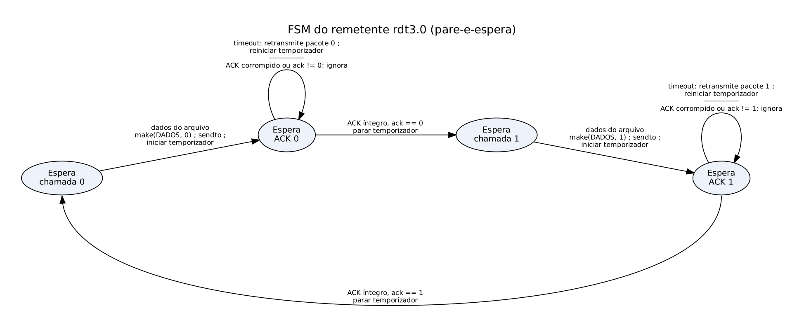

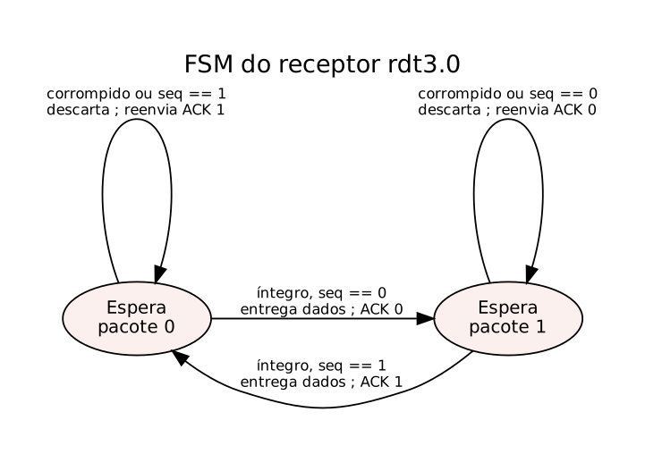

*Figuras 2.1 e 2.2 — FSM do remetente e do receptor do rdt3.0. A tabela que liga cada elemento da FSM ao trecho do código está em `relatorio/fsm_rdt30.md`.*

A implementação (`rdt30/remetente.py` e `rdt30/receptor.py`) recebe o socket como parâmetro e por isso funciona com o socket comum ou com o canal não confiável (seção 6). O remetente lê o arquivo em pedaços de 1024 bytes e, para cada um, envia o pacote e espera o ACK, tratando cada evento da FSM; depois de mais de 100 timeouts seguidos no mesmo pacote, levanta `ConnectionError`. Os dois lados devolvem estatísticas (tempo total, retransmissões, pacotes e ACKs corrompidos ou duplicados, bytes úteis) e, com `-v`, escrevem um log de eventos (`TIMEOUT`, `RETRANSMISSÃO`, `DUPLICADO`...).

### 2.4 Validação com SHA-256

O arquivo recebido é comparado ao enviado pelo **hash SHA-256** (`sha256_arquivo()`, `common/arquivo.py`): se um único bit diferir, o hash muda por completo. A validação roda em `testes/validar_rdt30.py` (cinco cenários de falha) e na suíte automatizada da seção 6. O rdt3.0 passou nos cinco cenários com hash igual (resultados na seção 6.3): sem falhas não há retransmissão, com perda há uma retransmissão por pacote perdido (27 para 27 e 55 para 55) e toda corrupção foi detectada pelo checksum. É o mais lento dos três, porque espera o ACK de cada pacote (seção 5).

---

## 3. Go-Back-N

### 3.1 Funcionamento

O Go-Back-N (GBN) é um protocolo de **janela deslizante**: o remetente pode ter até **N pacotes enviados e ainda não confirmados**, o que mantém o canal ocupado enquanto os ACKs voltam. Duas variáveis controlam a janela: `base`, o pacote mais antigo sem ACK, e `proximo`, o próximo a enviar. Ele só envia quando `proximo < base + N`.

- **ACK cumulativo:** um ACK `k` confirma todos os pacotes até `k`; o remetente faz `base = k + 1` e a janela desliza.
- **Temporizador único,** associado ao pacote `base`: liga ao enviar o primeiro pacote da janela, reinicia quando a base avança e para quando nada está em trânsito.
- **Timeout:** se o ACK de `base` não chega, o remetente **volta N** (*go back N*) e retransmite todos os pacotes de `base` até `proximo - 1`.
- **Receptor sem buffer:** aceita **somente o pacote esperado**. Pacote fora de ordem, duplicado ou corrompido é descartado, e o receptor reenvia o ACK do último pacote entregue em ordem.

Com N = 1 o GBN se reduz ao pare-e-espera. Quanto maior o N, mais pacotes em trânsito, mas cada perda custa mais caro, porque força a retransmissão da janela inteira (seção 5).

### 3.2 Máquina de estados e implementação

O remetente tem dois estados, **janela vazia** (temporizador parado) e **pacotes em trânsito** (temporizador ligado); o receptor tem um estado só, que espera o pacote `esperado`.

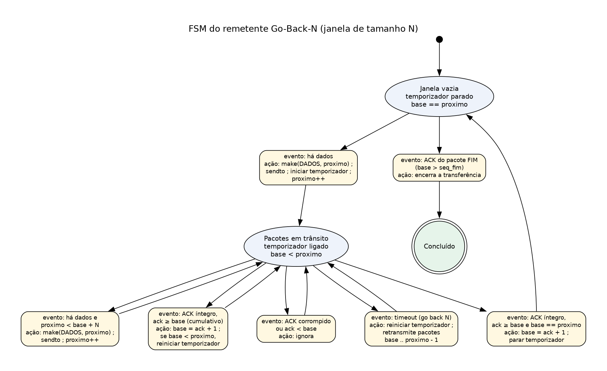

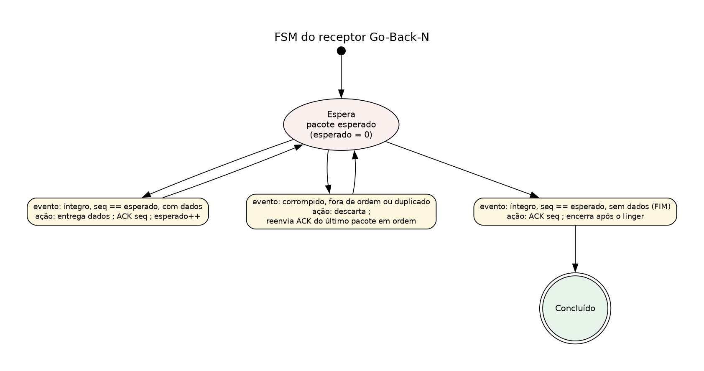

*Figuras 3.1 e 3.2 — FSM do remetente e do receptor do Go-Back-N. A tabela com o trecho de código de cada elemento está em `relatorio/fsm_gbn.md`.*

A implementação (`gbn/remetente.py` e `gbn/receptor.py`) segue o mesmo padrão do rdt3.0 e da SR, com os mesmos valores padrão (janela 8, timeout 0,1 s, 1024 bytes por pacote), para a comparação ser justa. O remetente é **uma thread só**: um laço alterna entre encher a janela e esperar um ACK até o prazo do temporizador, sem travas. O fim do arquivo é um pacote de dados vazio, que passa pela janela como os demais. Enquanto nada foi entregue, o receptor não envia ACK (o campo não tem sinal) e o remetente recupera por timeout.

Nos cinco cenários da suíte o GBN passou sempre com hash igual (seção 6.3). Com 10% de perda fez 88 retransmissões para 35 pacotes perdidos, enquanto o rdt3.0 e a SR fizeram 27: é o custo do *go back N*, em que cada timeout reenvia também pacotes que já tinham chegado.

---

## 4. Repetição Seletiva

### 4.1 Funcionamento

A Repetição Seletiva (SR, *Selective Repeat*) também usa **janela deslizante**, mas guarda o que chega fora de ordem e reenvia **só o pacote perdido**. O remetente usa as mesmas variáveis `base` e `proximo`, e as regras mudam assim:

- **ACK individual:** o ACK `k` confirma **só** o pacote `k`. A janela só desliza quando os primeiros pacotes dela estão todos confirmados.
- **Um temporizador por pacote:** liga ao enviar e desliga quando o ACK chega. No timeout, o remetente retransmite **só aquele pacote**.
- **Receptor com janela e buffer:** tem a sua janela `[rcv_base, rcv_base + N - 1]`. Todo pacote íntegro dentro dela recebe ACK; se chega fora de ordem, fica no buffer e, quando `rcv_base` chega, o receptor entrega esse e os seguintes já guardados, em ordem.
- **Duplicados e descartes:** um pacote já entregue (`seq < rcv_base`) tem o ACK repetido, sem entregar os dados de novo. Pacote corrompido ou acima da janela é descartado sem ACK, e o remetente recupera pelo temporizador.

Exemplo com N = 4 e o pacote 1 perdido:

| Momento | Go-Back-N | Repetição Seletiva |
| --- | --- | --- |
| Chegam 2 e 3 | descarta os dois (fora de ordem) | guarda os dois e envia ACK 2 e ACK 3 |
| Timeout do pacote 1 | reenvia 1, 2 e 3 | reenvia só o 1 |
| Chega o 1 | entrega o 1 e espera de novo o 2 e o 3 | entrega 1, 2 e 3 de uma vez |

O preço da economia é a complexidade: memória para o buffer no receptor e N temporizadores no remetente.

### 4.2 Máquina de estados e implementação

O remetente tem os mesmos dois estados do GBN, mas com um temporizador por pacote sem ACK; o receptor tem um estado, com a janela de recepção e o buffer.

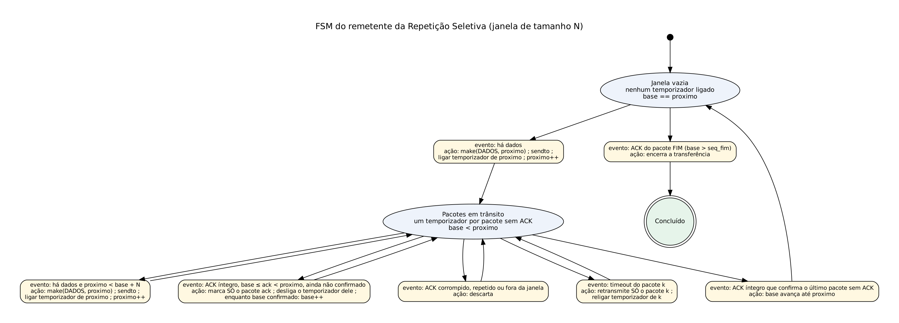

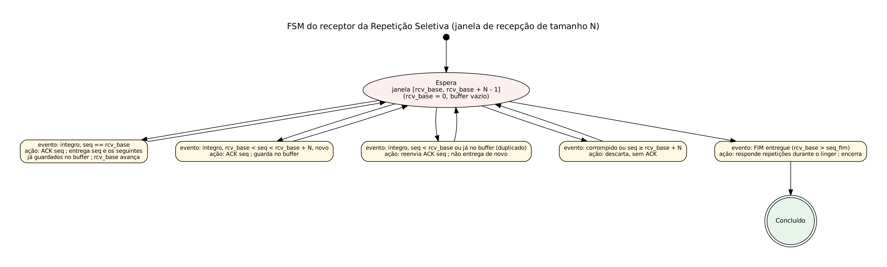

*Figuras 4.1 e 4.2 — FSM do remetente e do receptor da Repetição Seletiva (detalhes em `relatorio/fsm_sr.md`).*

A implementação (`sr/remetente.py` e `sr/receptor.py`) tem as mesmas funções, opções e estatísticas do GBN. O remetente guarda `prazos = {seq: prazo}` e espera o ACK até o **menor** prazo; se ele vence, reenvia só os pacotes vencidos (thread única, sem travas). Os confirmados fora de ordem ficam no conjunto `confirmados` até a base alcançá-los. No receptor, o dicionário `guardados = {seq: dados}` recebe os pacotes fora de ordem, e o laço `while rcv_base in guardados` grava tudo o que estiver contíguo. A janela do receptor deve ser igual à do remetente. Depois do FIM, o receptor responde por um tempo (*linger*) ao ACK de **cada** pacote repetido, porque os ACKs da última janela também podem ter se perdido. Como o número de sequência tem 4 bytes e não volta ao zero, a exigência teórica de N ≤ metade do espaço de números não é problema.

### 4.3 Diferença em relação ao Go-Back-N

| Característica | Go-Back-N | Repetição Seletiva |
| --- | --- | --- |
| ACK | cumulativo: `ack = k` confirma tudo até `k` | individual: confirma só o `k` |
| Temporizador | um só, do pacote `base` | um por pacote sem ACK |
| No timeout reenvia | todos de `base` a `proximo - 1` | só o pacote vencido |
| Fora de ordem no receptor | descartado | guardado no buffer e confirmado |
| Memória no receptor | nenhuma | até N pacotes |

Nos mesmos cenários e com a mesma semente, a SR retransmitiu bem menos que o GBN: 27 contra 88 com 10% de perda, 55 contra 178 com 20%, 66 contra 226 só com corrupção e 75 contra 206 no cenário misto. Nos testes curtos o tempo total não favorece a SR (0,86 s contra 0,68 s com 10% de perda), porque sem atraso nem limite de taxa reenviar a mais custa quase nada e os timeouts dominam; a vantagem aparece na seção 5, com capacidade limitada.

---

## 5. Comparação da utilização do canal

O rdt3.0 é correto, mas lento: com um pacote em trânsito por vez, o remetente passa quase todo o tempo esperando o ACK. Esta seção mede **quanto do enlace cada protocolo consegue usar** com o mesmo arquivo, a mesma perda e o mesmo atraso, variando a janela (requisito B).

### 5.1 Como os experimentos foram feitos

`testes/experimentos.py` transfere o mesmo arquivo pelos três protocolos, confere o SHA-256 e grava as métricas em `graficos/experimentos.jsonl`; `graficos/plot_utilizacao.py` gera o gráfico. Os parâmetros foram:

| Parâmetro | Valor |
| --- | --- |
| Arquivo | 100 KB pseudoaleatório (semente 42): 101 pacotes |
| Pacote | 1024 bytes de dados + 13 de cabeçalho = 1037 bytes |
| Enlace | 1 Mbit/s (um pacote leva 8,3 ms para sair) e 20 ms de atraso por sentido (RTT de 40 ms) |
| Perda | 0% e 5%, nos dois sentidos |
| Janela N | 1, 2, 4, 8, 16 e 32 (GBN e SR); o rdt3.0 é sempre N = 1 |
| Repetições | 3 por ponto (sementes 42, 1042 e 2042) |

O `EnlaceSocket` (`common/enlace.py`) herda do `UnreliableSocket` e modela um enlace real: os pacotes saem um de cada vez na taxa configurada e chegam depois do atraso; um pacote perdido ainda ocupa o enlace. O timeout cresce com a janela, `timeout = RTT + N x (L/R) + 50 ms` (de 98 ms a 355 ms), com a mesma regra para os três protocolos. A utilização é `U = (bytes úteis x 8 / R) / tempo total`.

### 5.2 Resultados

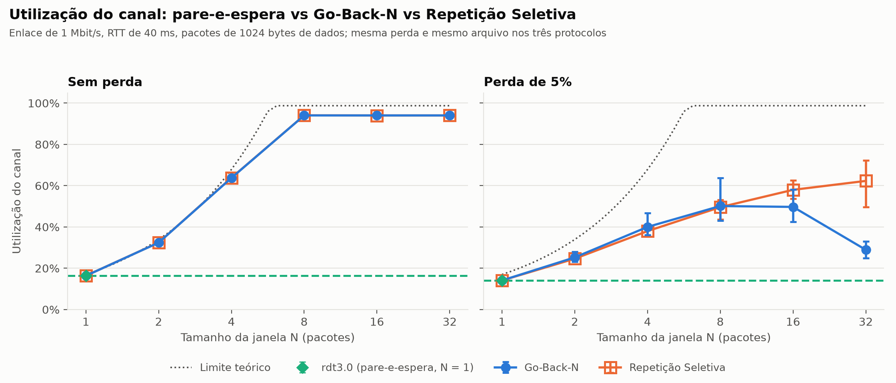

*Figura 5.1 — Utilização do canal em função da janela N, sem perda (esquerda) e com 5% de perda (direita). A linha pontilhada é o limite teórico; as barras vão do mínimo ao máximo das 3 repetições.*

| Janela N | GBN, sem perda | SR, sem perda | GBN, 5% de perda | SR, 5% de perda | Retransm. GBN | Retransm. SR |
| --- | --- | --- | --- | --- | --- | --- |
| 1 | 16,3% | 16,4% | 14,1% | 14,1% | 7,7 | 7,7 |
| 2 | 32,4% | 32,4% | 25,2% | 24,6% | 11,3 | 7,7 |
| 4 | 63,8% | 63,8% | 40,0% | 38,0% | 20,0 | 7,7 |
| 8 | 94,0% | 94,1% | 50,1% | 49,6% | 32,0 | 7,7 |
| 16 | 94,0% | 94,0% | 49,7% | 58,0% | 43,3 | 7,7 |
| 32 | 94,0% | 94,0% | 28,9% | 62,3% | 119,7 | 7,7 |
| rdt3.0 | 16,3% | — | 14,0% | — | — | — |

*As duas últimas colunas são a média de retransmissões por execução com 5% de perda. Valores de `graficos/utilizacao_resumo.csv`.*

### 5.3 Discussão

- **Pare-e-espera: o canal fica parado.** O ACK só volta depois de um RTT de 40 ms, e a fórmula da aula, `U = (L/R) / (RTT + L/R)`, dá cerca de 17%. O rdt3.0 mediu **16,3%**: o remetente passa mais de 80% do tempo esperando.
- **A janela enche o canal.** A utilização cresce quase linearmente com N (`U = N x (L/R) / (RTT + L/R)`): 32,4% com N = 2 e 63,8% com N = 4. São necessários cerca de 6 pacotes em trânsito, `(40 + 8,3) / 8,3`, então **N = 8 já satura** (94,0%) e N = 16 e 32 não melhoram. Os 94% e não 100% vêm do cabeçalho de 13 bytes (cerca de 1,3%) e do RTT final, porque o último ACK precisa voltar antes de a transferência acabar (cerca de 4,6%).
- **Sem perda, GBN e SR são iguais**, pois enviam os mesmos pacotes na mesma ordem.
- **Com perda, a política de retransmissão decide.** A SR retransmitiu 7,7 pacotes em todas as janelas, o mesmo valor do rdt3.0, e sua utilização continua crescendo, até 62,3% em N = 32. O GBN melhora até N = 8 (50,1%), fica estável em N = 16 e **cai para 28,9% em N = 32**: a cada timeout ele volta N e reenvia a janela inteira. Em N = 32, o GBN fez 119,7 retransmissões contra 7,7, enviou 220,7 pacotes contra 108,7 e levou 2,87 s contra 1,35 s. Como o timeout é o mesmo, a diferença vem só da política.
- **Ressalvas.** Com perda a variação entre repetições é grande (a SR em N = 32 foi de 49,7% a 72,3%), então os números sustentam a **tendência**, não a diferença exata de cada ponto. O enlace é emulado por threads em uma única máquina, com timeout fixo, duas taxas de perda e um arquivo, e a corrupção fica na suíte da seção 6.

**Conclusão.** A janela deslizante é o que torna o transporte confiável **eficiente**: com N = 8, GBN e SR usam cerca de 94% do enlace, contra 16% do pare-e-espera. Com perda, reenviar só o que se perdeu (SR) escala com a janela, e reenviar a janela inteira (GBN) deixa de compensar a partir de N = 8. O custo da SR é um temporizador por pacote e um buffer no receptor.

---

## 6. Injeção de falhas e testes

Na mesma máquina, o UDP quase nunca perde nem corrompe pacotes, então um protocolo confiável não teria o que corrigir. Esta seção descreve o canal que **injeta falhas de forma controlada** e a suíte que mostra que os três protocolos **detectam** o problema e **se recuperam** dele (requisito C).

### 6.1 O canal que simula a rede não confiável

A classe `UnreliableSocket` (`common/channel.py`) envolve um socket UDP e tem a mesma interface (`sendto`, `recvfrom`, `bind`, `settimeout`, `close`), então os protocolos a usam sem nenhuma outra mudança: `UnreliableSocket(loss=0.1, corrupt=0.05, delay=0.02, seed=42)`.

| Parâmetro | O que faz |
| --- | --- |
| `loss` | probabilidade de **perder** o pacote: o `sendto` finge que enviou, mas o descarta |
| `corrupt` | probabilidade de **corromper** o pacote, invertendo 1 bit em posição aleatória |
| `delay` | atraso de propagação, em segundos (padrão 0) |
| `seed` | semente do gerador, para o teste ser reproduzível |

A cada `sendto`, o canal sorteia se o pacote se perde e, se não se perdeu, se é corrompido, e mantém os contadores `enviados`, `perdidos` e `corrompidos`, que a suíte usa para provar que a falha aconteceu. Quem **detecta** a corrupção é o receptor, pelo checksum. A semente é fixa (remetente 42, receptor 43), então qualquer pessoa reproduz os números. Com `delay > 0`, o pacote vai para uma fila e uma **única thread** o entrega depois do atraso, preservando a ordem; assim o `sendto` volta na hora e a janela continua sendo enchida (uma versão inicial com `time.sleep` no `sendto` travava a janela e distorcia a medida de utilização).

### 6.2 Cenários e metodologia

A suíte (`testes/test_suite.py`, `unittest`) roda os **três protocolos em cinco cenários**, 15 testes, com perda e corrupção nos dois sentidos (dados e ACKs): sem falhas; 10% de perda; 20% de perda; só corrupção (20%); e perda 10% com corrupção 10%. Todos usam um arquivo pseudoaleatório de 100 KB, N = 8 para GBN e SR, timeout de 50 ms e semente fixa. Cada teste confere duas coisas:

1. **Entrega confiável:** o SHA-256 do recebido é igual ao do enviado.
2. **O mecanismo foi realmente acionado:** com perda, o canal precisa ter perdido pacotes e o remetente ter retransmitido; com corrupção, o checksum precisa ter detectado alguns; sem falhas, não pode haver retransmissão. Isso evita um teste que passa "por sorte".

A execução (`python -m unittest testes.test_suite -v`) gera `capturas/resultados_testes.md` e um log por teste em `capturas/logs_testes/`, com a sequência detecção, descarte, timeout e retransmissão.

### 6.3 Resultados

"Perdidos" e "corrompidos" somam o que o canal fez com dados e ACKs; "detectados" são os pacotes e ACKs que o checksum rejeitou.

| Protocolo | Cenário | Hash | Tempo (s) | Retransm. | Perdidos | Corrompidos | Detectados |
| --- | --- | --- | --- | --- | --- | --- | --- |
| rdt3.0 | sem falhas | OK | 0,02 | 0 | 0 | 0 | 0 |
| rdt3.0 | 10% de perda | OK | 1,67 | 27 | 27 | 0 | 0 |
| rdt3.0 | 20% de perda | OK | 3,40 | 55 | 55 | 0 | 0 |
| rdt3.0 | só corrupção (20%) | OK | 3,91 | 63 | 0 | 75 | 75 |
| rdt3.0 | perda 10% + corrupção 10% | OK | 4,10 | 66 | 38 | 37 | 37 |
| GBN | sem falhas | OK | 0,03 | 0 | 0 | 0 | 0 |
| GBN | 10% de perda | OK | 0,68 | 88 | 35 | 0 | 0 |
| GBN | 20% de perda | OK | 1,49 | 178 | 95 | 0 | 0 |
| GBN | só corrupção (20%) | OK | 1,80 | 226 | 0 | 139 | 139 |
| GBN | perda 10% + corrupção 10% | OK | 1,61 | 206 | 67 | 59 | 59 |
| SR | sem falhas | OK | 0,03 | 0 | 0 | 0 | 0 |
| SR | 10% de perda | OK | 0,86 | 27 | 27 | 0 | 0 |
| SR | 20% de perda | OK | 1,49 | 55 | 55 | 0 | 0 |
| SR | só corrupção (20%) | OK | 1,49 | 66 | 0 | 66 | 66 |
| SR | perda 10% + corrupção 10% | OK | 2,04 | 75 | 38 | 37 | 37 |

- **Os 15 testes passaram, com hash igual**, mesmo com 20% de perda ou de corrupção.
- **Sem falhas não há retransmissão**, então o timeout de 50 ms não dispara à toa.
- **Toda corrupção foi detectada:** corrompidos é igual a detectados em todos os cenários (por exemplo, 139 de 139 no GBN).
- **Uma perda, uma retransmissão no rdt3.0 e na SR** (27 e 55); o **GBN retransmite mais** (88 para 35 perdas), pois reenvia a janela inteira a cada timeout.
- **Os tempos mostram só a ordem de grandeza:** são transferências curtas, que dependem do timeout e da máquina.

Os logs mostram a sequência nos três protocolos. No rdt3.0, `TIMEOUT seq=0`, `RETRANSMISSÃO seq=0` e `DUPLICADO seq=0 (esperado 1) -> descartado, reenvia ACK 0` indicam que só o ACK se perdeu e que a numeração 0/1 identificou a cópia. No GBN, `FORA DE ORDEM seq=7 (esperado 6) -> descartado, reenvia ACK 5` e depois `TIMEOUT base=6 -> reenvia 6..13` mostram o go-back da janela inteira. Na SR, só os pacotes com temporizador vencido são reenviados, e os que chegaram fora de ordem ficam em `FORA DE ORDEM ... guardado no buffer`.

**Limitações.** Cada cenário é uma única sequência de sorteios (semente fixa), então os tempos variariam com outras sementes. O canal inverte 1 bit por pacote, caso que o checksum de 16 bits sempre detecta; corrupções de vários bits e reordenação não foram testadas.

---

## 7. Análise de uma conexão TCP real

Esta seção dissecta uma conexão TCP capturada no Wireshark (`capturas/captura_tcp_http.pcapng`, 167 pacotes, HTTP simples na porta 80, filtro `tcp.port == 61097`; prints anotados em `capturas/prints_tcp/`) e compara o ACK cumulativo do TCP com o do GBN e o da SR. Os números de sequência são os relativos do Wireshark. Cliente e servidor usam IPv6; os ISNs são 2428730781 (cliente) e 543639397 (servidor).

### 7.1 Handshake de três vias

A conexão só foi estabelecida na quinta tentativa de SYN (frame 101), e o handshake terminou com o ACK do cliente no frame 104, aos 18,173 s.

| Frame | Sentido | Flags | Seq | Ack | Janela (bytes) |
| --- | --- | --- | --- | --- | --- |
| 101 | cliente → servidor | SYN | 0 | — | 64800 |
| 103 | servidor → cliente | SYN, ACK | 0 | 1 | 26883 |
| 104 | cliente → servidor | ACK | 1 | 1 | 64800 |

- **Os SYNs consomem um número de sequência:** o servidor confirma com Ack=1 (ISN do cliente + 1), e o primeiro byte de dados terá Seq=1. Cada lado escolhe o seu ISN.
- **Janela.** O cliente anuncia 64800 bytes e o servidor 26883. O SYN-ACK não traz a opção de escala de janela, então a janela calculada é igual ao campo Window.
- **iRTT.** O intervalo entre o SYN (frame 101) e o ACK (frame 104) é de 158,2 ms.

### 7.2 Troca de dados: sequência, ACK e janela

O cliente enviou 77 bytes (`GET / HTTP/1.1`) e recebeu 4261 bytes em três segmentos. Em todo o fluxo, o ACK é o número de sequência mais os bytes recebidos em ordem.

| Frame | Tempo (s) | Sentido | Seq | Ack | Bytes de dados | Janela |
| --- | --- | --- | --- | --- | --- | --- |
| 105 | 18,173 | cliente → servidor | 1 | 1 | 77 (GET) | 64800 |
| 109 | 21,332 | servidor → cliente | 1 | 78 | 0 | 28800 |
| 110 | 21,391 | servidor → cliente | 1 | 78 | 1440 | 28800 |
| 111 | 21,391 | servidor → cliente | 1441 | 78 | 1440 | 28800 |
| 112 | 21,391 | cliente → servidor | 78 | 2881 | 0 | 64800 |
| 113 | 21,391 | servidor → cliente | 2881 | 78 | 1381 (200 OK) | 28800 |

- **Sequência e ACK.** O GET ocupa os bytes 1 a 77 e o servidor responde Ack=78. Os três segmentos (1440 + 1440 + 1381 = 4261 bytes) são confirmados por inteiro com Ack=4262 no frame 114. O MSS de 1440 bytes anunciado no SYN preenche os dois primeiros segmentos.
- **Controle de fluxo.** A janela do servidor passou de 26883 para 28800 e a do cliente, de 64800 para 63419 no FIM, uma diferença de 1381 bytes, igual ao último segmento recebido.

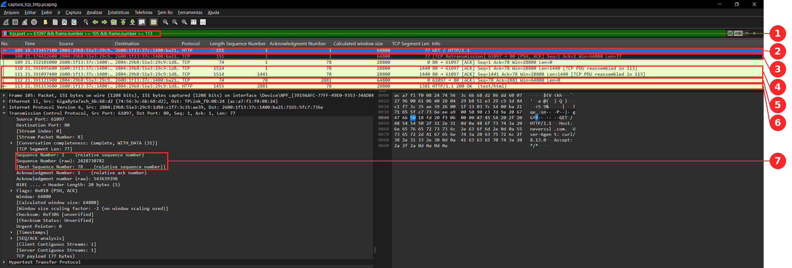

*Figura 7.1 — Frames 105 a 113: o GET (105) e sua retransmissão em vermelho (108), o ACK do servidor (109), dois segmentos de 1440 bytes (110 e 111), o ACK cumulativo do cliente (112, Ack=2881) e o último segmento com o 200 OK (113).*

### 7.3 Retransmissões e timeout

O TCP retransmitiu o SYN quatro vezes e depois o GET uma vez, sempre por estouro de temporizador (não houve ACKs duplicados). O servidor só respondeu ao quinto SYN, 15,16 s depois do primeiro.

| Frame | Tempo (s) | Segmento | Intervalo desde o anterior (s) |
| --- | --- | --- | --- |
| 7 | 3,013 | SYN | — |
| 11 | 4,015 | SYN (retransmissão 1) | 1,0 |
| 18 | 6,015 | SYN (retransmissão 2) | 2,0 |
| 28 | 10,016 | SYN (retransmissão 3) | 4,0 |
| 101 | 18,015 | SYN (retransmissão 4) | 8,0 |
| 105 | 18,173 | GET (original) | — |
| 108 | 21,174 | GET (retransmissão) | 3,0 |

- **Backoff exponencial.** Os intervalos entre os SYNs dobram a cada tentativa (1, 2, 4 e 8 s), para não sobrecarregar uma rede possivelmente congestionada. O intervalo de 3 s no GET coincide com o RTO inicial de 3 s da RFC 6298 (seção 5.7).
- **Relação com o rdt3.0.** É o mesmo mecanismo de temporizador do rdt3.0 e do GBN, mas o TCP calcula o tempo limite a partir do RTT medido e o duplica a cada falha, enquanto os protocolos do grupo usam um timeout fixo de 0,1 s.

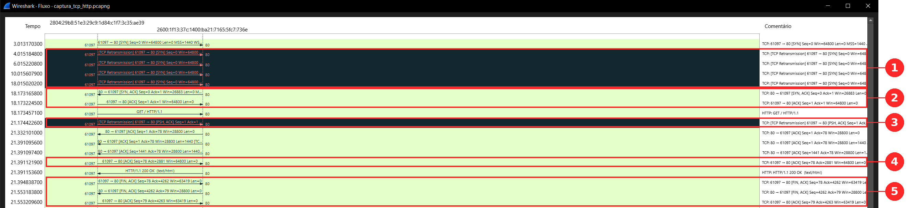

*Figura 7.2 — Flow Graph da conexão inteira: as linhas escuras são as retransmissões (quatro SYNs e o GET); o handshake termina em 18,17 s e o Ack=2881 confirma de uma vez os dois segmentos de 1440 bytes.*

### 7.4 Encerramento (FIN/ACK)

O cliente iniciou o fechamento, em três segmentos e não em quatro, porque o servidor juntou o ACK do FIN do cliente com o seu próprio FIN.

| Frame | Tempo (s) | Sentido | Flags | Seq | Ack | Janela |
| --- | --- | --- | --- | --- | --- | --- |
| 114 | 21,395 | cliente → servidor | FIN, ACK | 78 | 4262 | 63419 |
| 119 | 21,553 | servidor → cliente | FIN, ACK | 4262 | 79 | 28800 |
| 120 | 21,553 | cliente → servidor | ACK | 79 | 4263 | 63419 |

O FIN consome um número de sequência, como o SYN. O Ack=4262 do frame 114 também confirma os 4261 bytes da resposta, e o servidor respondeu ao FIN em 158 ms, próximo do iRTT do handshake.

### 7.5 ACK cumulativo do TCP versus GBN e Repetição Seletiva

O TCP usa ACK cumulativo, como o GBN, mas retransmite como a SR: na captura, o ACK do frame 112 (Ack=2881) confirmou de uma vez os dois segmentos dos frames 110 e 111, enquanto na SR cada um receberia um ACK individual.

| Característica | TCP | GBN (grupo) | Repetição Seletiva (grupo) |
| --- | --- | --- | --- |
| Unidade numerada | byte | pacote | pacote |
| Tipo de ACK | cumulativo: Ack = próximo byte esperado | cumulativo | individual, por pacote |
| Fora de ordem | em geral fica no buffer; o ACK repete o último byte em ordem | descartado | guardado e confirmado |
| Retransmissão por timeout | só o segmento mais antigo sem ACK | toda a janela a partir da base | só o pacote vencido |
| Timeout | calculado a partir do RTT e dobrado a cada falha | fixo (0,1 s) | fixo (0,1 s) |
| Aviso de perda sem timeout | 3 ACKs duplicados; SACK opcional | não há | o ACK individual mostra o que falta |
| Janela | anunciada pelo receptor e limitada pela rede | N pacotes (N = 8) | N pacotes (N = 8) |

A captura comprova o ACK cumulativo, a retransmissão por timeout e a janela anunciada. Como não houve perda de dados nem pacotes fora de ordem, não aparecem ACKs duplicados nem retransmissão rápida, e o SACK não foi negociado: essas linhas da tabela vêm da especificação do TCP, não da captura.

---

## 8. Por que o TCP é justo (fairness)

O TCP é justo porque cada fluxo aumenta a janela de congestionamento de forma aditiva e a reduz de forma multiplicativa (AIMD), o que faz fluxos que dividem o mesmo gargalo convergirem para taxas iguais. Um protocolo é justo quando n fluxos pelo mesmo gargalo de capacidade R ficam com cerca de R/n cada um.

- **Aumento aditivo.** Sem perdas, cada fluxo soma 1 segmento à janela por RTT; os dois ganham o mesmo tanto, e a diferença entre as janelas não muda.
- **Redução multiplicativa.** Ao detectar perda, cada fluxo multiplica a janela por um fator menor que 1; a diferença encolhe na mesma proporção, e o fluxo maior perde mais em valor absoluto.
- **Convergência.** Repetido a cada perda, o ciclo aproxima as janelas (argumento de Chiu e Jain) e a soma das taxas oscila em torno da capacidade do enlace.
- **Limites.** Fluxos com RTT menor crescem mais rápido e ficam com fatia maior; quem abre várias conexões recebe mais; e um fluxo UDP, que não reduz a taxa, não é justo com o TCP.

### 8.1 Medição com dois fluxos

A topologia (`testes/topologia_gargalo.py`, Mininet) liga h1 a h2 por um switch: acesso de 100 Mbit/s e 5 ms, e gargalo de 5 Mbit/s, 20 ms e fila de 15 pacotes, o que dá um RTT base de 50 ms. Dois fluxos `iperf3` foram de h1 para h2, o fluxo 1 a partir de 0 s e o fluxo 2 a partir de 5 s, e a cwnd foi coletada com `ss -ti` (`capturas/cwnd_fluxo1.txt` e `cwnd_fluxo2.txt`).

| Medida | Fluxo 1 | Fluxo 2 |
| --- | --- | --- |
| Início | 0 s | 5 s |
| Dados confirmados (`bytes_acked`) | 8,51 MB | 6,10 MB |
| cwnd média de 10 s a 20 s | 34,3 | 32,3 |
| Faixa da cwnd de 10 s a 20 s | 27 a 39 | 19 a 41 |
| Pico da cwnd (partida lenta) | 46 | 75 |
| Bytes retransmitidos | 0,53% | 1,78% |
| RTT mínimo | 51,6 ms | 52,6 ms |

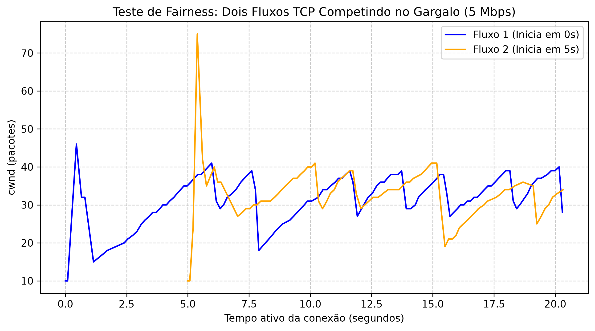

*Figura 8.1 — cwnd dos dois fluxos TCP no gargalo de 5 Mbit/s. Depois do pico de 75 segmentos do fluxo 2 ao entrar, as duas curvas oscilam na mesma faixa, com quedas em momentos diferentes.*

- **Entrada do fluxo 2.** Sua partida lenta chega a 75 segmentos e enche a fila; o fluxo 1 sofre uma redução logo depois (de 41 para cerca de 31), e por isso o fluxo 2 retransmitiu mais (1,78% contra 0,53%).
- **Divisão do gargalo.** Os RTTs mínimos são quase iguais, então os dois crescem na mesma velocidade. Entre 5 s e 20 s, o fluxo 1 ficou com cerca de 53% dos bytes confirmados e o fluxo 2 com cerca de 47%, um índice de Jain de 0,997 (1 é igualdade perfeita).
- **Ressalvas.** Foi uma única execução, com os dois fluxos com o mesmo RTT. O `ss` não grava horário, então o tempo foi estimado pelo campo `busy`, e por isso só a proporção entre os fluxos é usada, não as taxas absolutas.

---

## 9. Controle de congestionamento (bônus)

Para observar o controle de congestionamento em atuação, usou-se a mesma topologia com gargalo (`testes/topologia_gargalo.py`, `TCLink` do Linux), dimensionada pelo produto banda-atraso. O RTT base é `2 × (5 ms + 20 ms) = 50 ms`, e a capacidade em trânsito no gargalo é `5 Mbit/s × 0,05 s = 31.250 bytes`, cerca de **20,8 pacotes** de 1500 bytes. Com a fila de **15 pacotes** (menos de 1 BDP), o buffer enche sempre que o envio supera os 5 Mbit/s, o que provoca descartes por *tail drop* e aciona a recuperação do TCP. O tráfego foi gerado com `iperf3` por 15 s e a cwnd coletada com `ss -ti` (`capturas/cwnd_log.txt`); no gráfico, a conexão de controle do `iperf3` (fixa em `cwnd = 10`) foi filtrada.

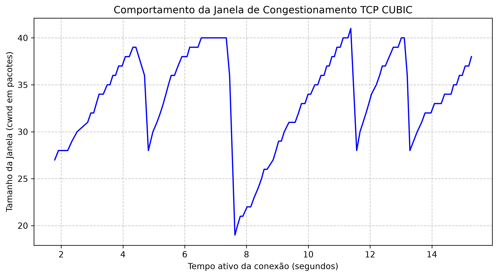

*Figura 9.1 — Evolução da `cwnd` de um fluxo TCP CUBIC pelo gargalo de 5 Mbit/s com fila de 15 pacotes. O eixo horizontal usa o tempo ativo da conexão (`busy`).*

O gráfico mostra o **dente-de-serra** do TCP CUBIC, padrão do Linux:

- **Partida lenta.** A `cwnd` cresce exponencialmente a cada RTT até encher o enlace e a fila. Esse trecho inicial não aparece na Figura 9.1 (que começa em 27 segmentos), mas está na Figura 8.1, onde o fluxo 1 sobe de 10 a 46 segmentos em menos de 1 s.
- **Saturação e descarte.** Quando a janela chega ao teto do caminho (picos de **39 a 41 pacotes**, entre os pacotes no enlace e os retidos na fila), o pacote seguinte encontra a fila cheia e é descartado.
- **Redução multiplicativa.** Ao detectar a perda por ACKs duplicados, o CUBIC reduz a janela por um fator de cerca de **0,7**, e não pela metade como o Reno: de picos de ~40 para ~28 pacotes (com uma queda a 19 em ~7,6 s, após perdas consecutivas).
- **Recuperação.** A janela volta a crescer em função cúbica até ~40 pacotes e repete o ciclo, mantendo o gargalo quase sempre ocupado.

---

## 10. Conclusão

Os três protocolos do grupo entregaram o arquivo idêntico ao original em todos os cenários de falha, e a comparação com o TCP mostrou de onde vêm as diferenças de desempenho.

- **Confiabilidade comprovada.** Os 15 testes (3 protocolos em 5 cenários, com até 20% de perda ou de corrupção) terminaram com SHA-256 igual, e toda corrupção foi detectada pelo checksum.
- **O pare-e-espera desperdiça o canal.** Com 1 Mbit/s e RTT de 40 ms, o rdt3.0 usou 16,3% da taxa, perto dos 17% da fórmula da aula.
- **A janela enche o canal.** GBN e SR chegam a cerca de 94% com N = 8, o que corresponde aos cerca de 6 pacotes em trânsito necessários para ocupar o enlace.
- **Com perda, a política de retransmissão decide.** Com 5% de perda e N = 32, a SR chegou a 62,3% e o GBN caiu para 28,9% (119,7 retransmissões contra 7,7). Os resultados com perda variam entre as repetições, então o que se sustenta é a tendência.
- **O TCP real usa os mesmos mecanismos.** A captura mostrou o handshake, o ACK cumulativo (Ack=2881 confirmando dois segmentos) e a retransmissão por timeout com recuo exponencial de 1, 2, 4 e 8 s.
- **O TCP é justo e controla o congestionamento.** No gargalo de 5 Mbit/s, a cwnd mostrou o dente-de-serra do CUBIC (redução a cerca de 0,7, picos de 39 a 41 segmentos), e dois fluxos dividiram o enlace em 53% e 47%, com índice de Jain de 0,997.

**Limitações.** Os protocolos usam timeout fixo, sem medir o RTT como o TCP; os experimentos cobrem duas taxas de perda, um arquivo de 100 KB, um RTT e 3 repetições por ponto; o canal inverte só 1 bit por pacote; o TCP foi observado em uma conexão e a fairness em uma execução. Como trabalho futuro ficam o timeout adaptativo (RFC 6298), a retransmissão rápida e o SACK, e um CRC no lugar do checksum de 16 bits.

**Divisão do trabalho.**

| Integrante | Frente |
| --- | --- |
| Lucas | formato do pacote, rdt3.0, enlace simulado, experimentos e gráfico de utilização, integração e entrega |
| Márcio | Go-Back-N e consolidação deste relatório |
| João Pedro | Repetição Seletiva, README e FSMs da SR |
| João Vitor | canal com perda, corrupção e atraso, suíte de testes e logs |
| José Fernando | captura e análise do TCP real, texto sobre justiça do TCP |
| Elias | topologia no Mininet, medições da cwnd e gráficos, slides do seminário |

---

## Referências

1. KUROSE, J. F.; ROSS, K. W. **Redes de computadores e a Internet: uma abordagem top-down.** São Paulo: Pearson. Capítulo 3, Camada de transporte.
2. POSTEL, J. **RFC 768: User Datagram Protocol.** IETF, 1980.
3. EDDY, W. **RFC 9293: Transmission Control Protocol (TCP).** IETF, 2022.
4. BRADEN, R.; BORMAN, D.; PARTRIDGE, C. **RFC 1071: Computing the Internet Checksum.** IETF, 1988.
5. PAXSON, V. et al. **RFC 6298: Computing TCP's Retransmission Timer.** IETF, 2011.
6. ALLMAN, M.; PAXSON, V.; BLANTON, E. **RFC 5681: TCP Congestion Control.** IETF, 2009.
7. XU, L. et al. **RFC 9438: CUBIC for Fast and Long-Distance Networks.** IETF, 2023.
8. CHIU, D.-M.; JAIN, R. Analysis of the increase and decrease algorithms for congestion avoidance in computer networks. **Computer Networks and ISDN Systems**, v. 17, n. 1, p. 1-14, 1989.
9. WIRESHARK FOUNDATION. **Wireshark User's Guide.** https://www.wireshark.org/docs/.
10. MININET PROJECT. **Mininet: an instant virtual network on your laptop.** https://mininet.org.
11. ESNET. **iperf3 documentation.** https://software.es.net/iperf/.
